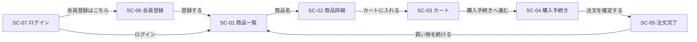

# ecsite 画面一覧

ECサイトの画面一覧・URL・画面遷移を定義する。共通の画面仕様は [画面共通仕様書](ecsite-画面共通仕様書.md) を参照。

## 2. 画面一覧

画面のURL（フロントエンドのルート）は以下のとおり。`/` は `/products` へ遷移する（履歴を置き換える）。

| 画面ID | 画面名称 | URL | ログイン要否 | 設計書 |
|---|---|---|---|---|
| SC-01 | 商品一覧画面 | `/products` | 不要 | ecsite-SC-01_商品一覧画面設計書.md |
| SC-02 | 商品詳細画面 | `/products/:id` | 不要 | ecsite-SC-02_商品詳細画面設計書.md |
| SC-03 | カート画面 | `/cart` | 必要 | ecsite-SC-03_カート画面設計書.md |
| SC-04 | 購入手続き画面 | `/checkout` | 必要 | ecsite-SC-04_購入手続き画面設計書.md |
| SC-05 | 注文完了画面 | `/orders/:orderNumber/complete` | 必要 | ecsite-SC-05_注文完了画面設計書.md |
| SC-06 | 会員登録画面 | `/signup` | 不要（ログイン中は表示しない） | ecsite-SC-06_会員登録画面設計書.md |
| SC-07 | ログイン画面 | `/login` | 不要（ログイン中は表示しない） | ecsite-SC-07_ログイン画面設計書.md |
| - | ページが見つかりません | 上記以外のURL等（画面共通仕様書6章） | 不要 | [画面共通仕様書6章](ecsite-画面共通仕様書.md#6-エラー画面) |
| - | システムエラー | APIエラー時（6章） | 不要 | [画面共通仕様書6章](ecsite-画面共通仕様書.md#6-エラー画面) |

### 画面遷移

共通ヘッダー（画面共通仕様書3章）からは、全画面からサイト名で SC-01、「カート」で SC-03、「ログイン」で SC-07、「会員登録」で SC-06 へ遷移できる。
