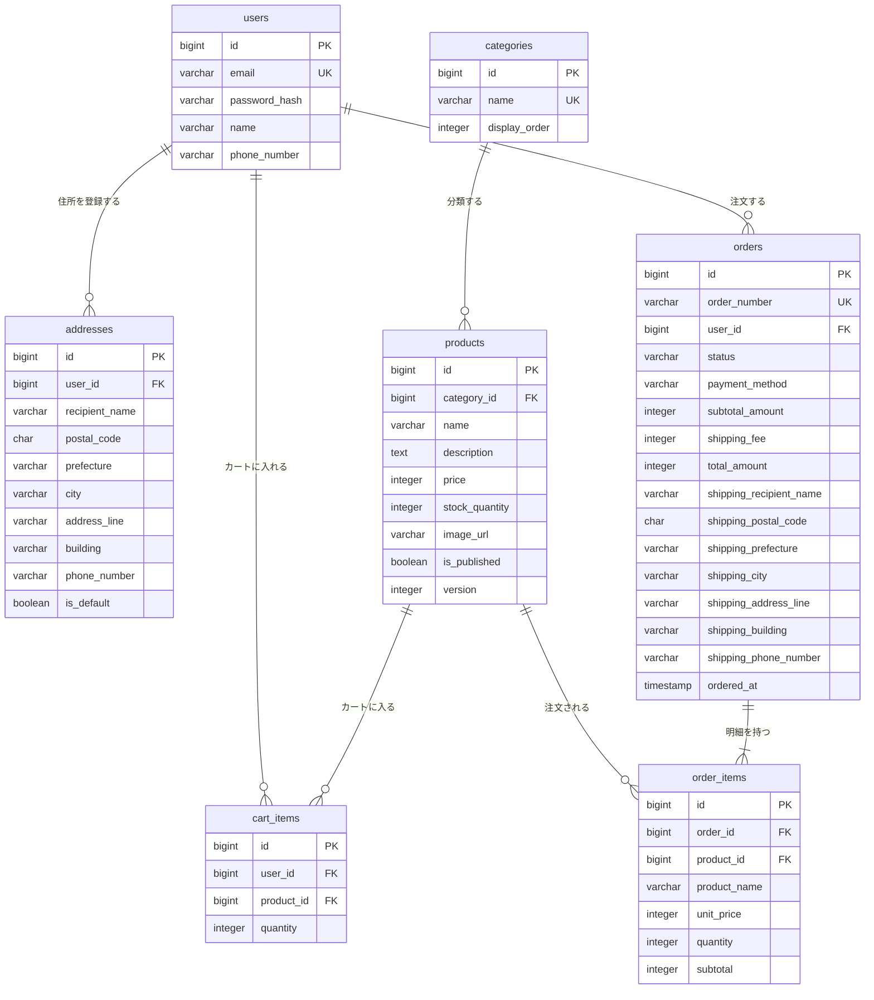

# ec-site ER図（物理名版）

ECサイトのテーブル間の関係を物理名で表示する。論理名での表示は [ER図（論理名版）](ec-site-ER図_論理名.md)、設計方針・共通カラム・各テーブルの詳細は [テーブル定義書](ec-site-テーブル定義書.md) を参照。

## 1. ER図

共通の作成日時・更新日時は省略する。

## 2. テーブル一覧

| テーブル | 論理名 | 概要 |
|---|---|---|
| `users` | ユーザー | 会員登録したユーザー。ログインIDはメールアドレス |
| `addresses` | 配送先住所 | ユーザーが登録する配送先。1ユーザーに複数件、うち1件を既定にできる |
| `categories` | カテゴリ | 商品の分類。商品一覧の絞り込みに使う |
| `products` | 商品 | 販売する商品と在庫数 |
| `cart_items` | カート明細 | ユーザーのカートに入っている商品と数量 |
| `orders` | 注文 | 購入確定した注文のヘッダ。配送先・金額を購入時点の値で保持する |
| `order_items` | 注文明細 | 注文に含まれる商品。商品名・単価を購入時点の値で保持する |
