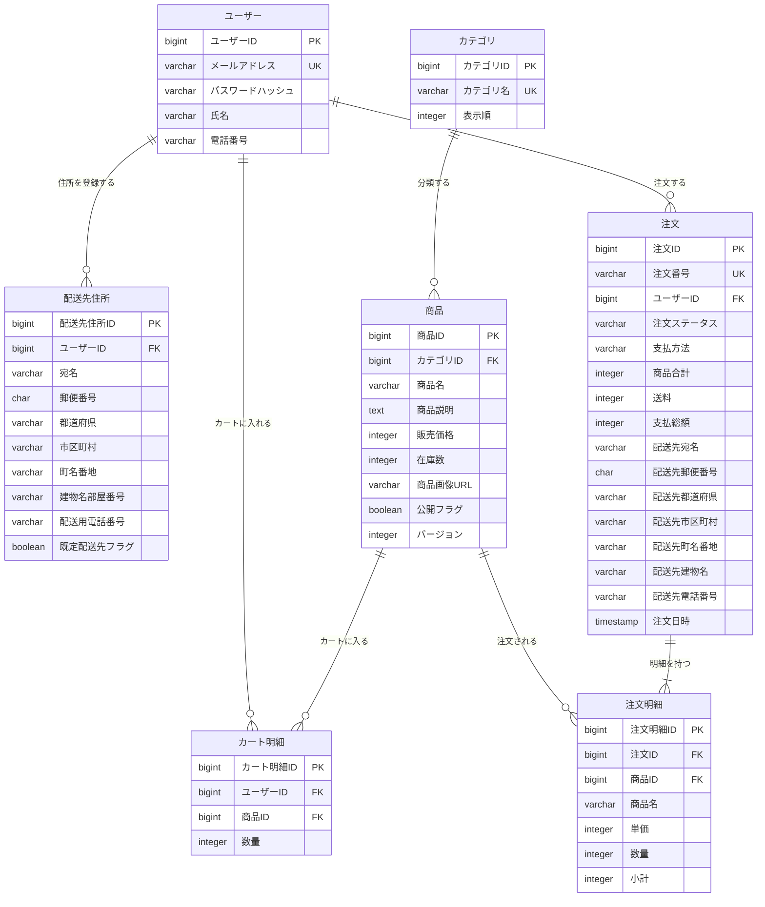

# ec-site ER図（論理名版）

ECサイトのテーブル間の関係を論理名で表示する。物理名での表示とテーブル一覧は [ER図（物理名版）](ec-site-ER図_物理名.md)、設計方針・共通カラム・各テーブルの詳細は [テーブル定義書](ec-site-テーブル定義書.md) を参照。

## 1. ER図

テーブル名・項目名を論理名で表示する。型・キー・関連・多重度は物理名版と同じ。共通の作成日時・更新日時は省略する。

